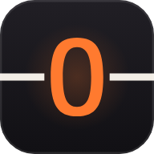
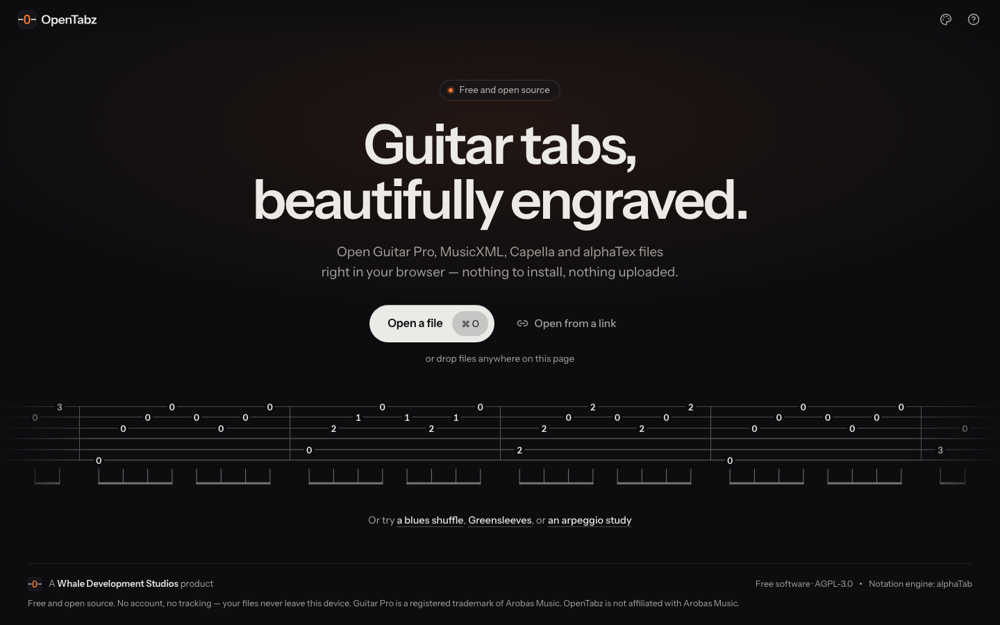
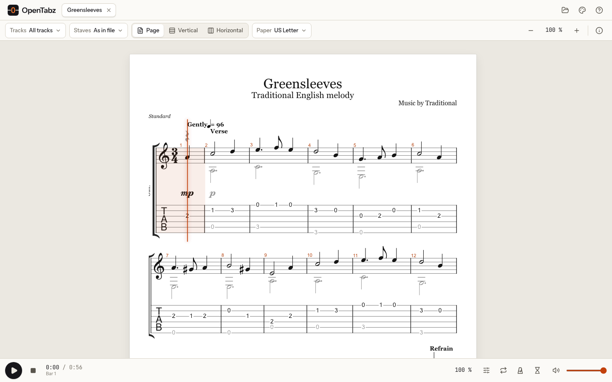
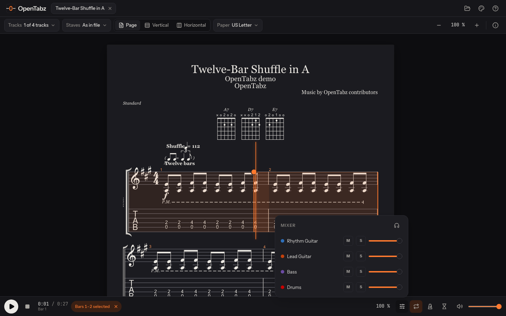
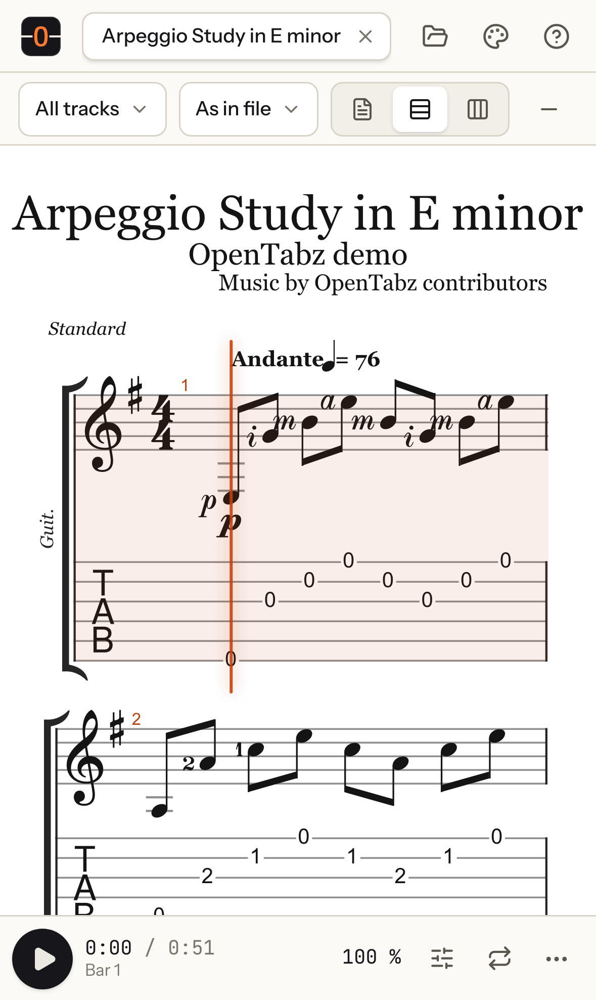

<p align="center">
  
</p>

<h1 align="center">OpenTabz</h1>

<p align="center"><strong>Guitar tabs, beautifully engraved — free, open source, in your browser.</strong></p>

<p align="center"><a href="https://opentabz.com">opentabz.com</a></p>



OpenTabz opens Guitar Pro, MusicXML, Capella and alphaTex files right in the browser, engraves
them as notation and tablature, plays them back and helps you practise them. Nothing to install,
no account, and your files never leave your device: there is no server to upload them to.

The goal is simple and large: everything Guitar Pro 8 does, then more, as free software.
[docs/PARITY.md](docs/PARITY.md) maps every Guitar Pro 8 capability (701 of them) to the work
that delivers it, and [docs/FEATURE_MATRIX.md](docs/FEATURE_MATRIX.md) tracks what is done.

## What it does today

**Open anything you have.** Guitar Pro 3, 4, 5, 6 (`.gpx`) and 7/8 (`.gp`), MusicXML
(`.xml`, `.musicxml`, compressed `.mxl`), Capella (`.capx`) and alphaTex. Drop files anywhere on
the page, use the file picker, paste a file or score text, or open a link
(`https://opentabz.com/?url=…`). Formats are recognised by their content, not their extension,
and a file that cannot be opened says exactly why: truncated, damaged, or a format OpenTabz
recognises but does not open yet (MIDI, PowerTab, TuxGuitar, PDF…).

**Read it beautifully.** Notation and tablature, either one alone, or as the file asks; pages on
A4 or US Letter, a vertical scroll, or one endless horizontal line; any selection of tracks; zoom
from 25 % to 400 %; four themes (light, dark, sepia, high-contrast stage) that never re-render
the music.



**Play and practise.** Playback with a SoundFont synthesizer running off the main thread, a
cursor that follows the music and turns pages for you, click-to-seek, and speed from 10 % to
300 % without changing the pitch (or tap the tempo you want). A metronome with six sounds, one to
four clicks per beat, swing, half time, accents you set beat by beat, polyrhythms and silent bars
to practise keeping time; a count-in of one or two bars, shown large on screen, fitted to where
you start and, if you like, before every pass of a loop; and a standalone metronome with tap
tempo for practising without a song. A mixer with mute, solo and level per track, plus a
practice mode that mutes the parts you are playing yourself. Drag across the music (or
long-press a bar on a phone) to select a range, then loop it seamlessly.



**On your phone, too.** Every screen is designed for phones first: the score, the playback bar
and the selection handles all work with touch.

<p align="center"></p>

Keyboard shortcuts and gestures are listed in [docs/SHORTCUTS.md](docs/SHORTCUTS.md).

## OpenTabz and Guitar Pro 8

|                                                     | Guitar Pro 8                | OpenTabz today                                                   |
| --------------------------------------------------- | --------------------------- | ---------------------------------------------------------------- |
| Price and licence                                   | Paid, proprietary           | Free, open source (AGPL-3.0-or-later)                            |
| Runs on                                             | Windows and macOS (desktop) | Any current browser on any device, phones included; no install   |
| Opens Guitar Pro 3–8 and MusicXML                   | Yes                         | Yes                                                              |
| Opens Capella and alphaTex                          | No                          | Yes                                                              |
| Opens PowerTab, TablEdit, MIDI                      | Yes                         | Planned (MIDI M5, PowerTab and TablEdit M8)                      |
| Notation and tab; page, scroll and horizontal views | Yes                         | Yes                                                              |
| Playback, mixer, speed, metronome, count-in, loops  | Yes                         | Yes                                                              |
| Metronome sounds, subdivisions, accents, polyrhythm | Not documented              | Yes, plus swing, silent bars and a standalone metronome          |
| Speed trainer, fretboard and keyboard views         | Yes                         | Planned (M1–M2)                                                  |
| Writing and editing scores                          | Yes                         | Planned (M4–M5)                                                  |
| Realistic instrument sound engine                   | Yes (RSE)                   | SoundFont playback now; a full sound engine is planned (M7)      |
| Export to PDF, MIDI, MusicXML, audio                | Yes                         | Planned (M2–M7)                                                  |
| Works offline                                       | Yes                         | Planned (M3)                                                     |
| Your files stay on your device                      | Yes                         | Yes: nothing is ever uploaded; no analytics, cookies or tracking |

The milestones are described in [docs/FEATURE_MATRIX.md](docs/FEATURE_MATRIX.md).

## How it is built

A React interface on the main thread, and an engine in a Web Worker that reads files, lays out
and paints the music as SVG and generates MIDI with [alphaTab](https://github.com/CoderLine/alphaTab).
Sound is synthesized in a second worker and streamed to an AudioWorklet through shared memory,
so neither a busy interface nor a large score can make the audio stutter. Performance budgets are
tested on every change: the app is interactive in well under a second, a 150-bar score renders
about 150 ms after you drop it, and playback starts within 100 ms.

- [docs/ARCHITECTURE.md](docs/ARCHITECTURE.md) — how the pieces fit together
- [docs/DECISIONS.md](docs/DECISIONS.md) — architecture decision records
- [docs/RESEARCH.md](docs/RESEARCH.md) — measurements and research behind the decisions
- [docs/upstream/](docs/upstream/) — OpenTabz's changes to alphaTab, written up for upstream

## Development

Requirements: Node.js 24 and pnpm 10 (`corepack enable pnpm`).

```bash
pnpm install
pnpm dev                 # http://localhost:5173
pnpm check               # typecheck, lint, format check and unit tests
pnpm build               # production build in apps/web/dist
node scripts/check-budgets.ts   # bundle budgets for the build
pnpm test:e2e            # end-to-end tests and performance budgets (Playwright)
pnpm fixtures            # regenerate fixtures/generated/
```

The end-to-end tests run against the production build with the production security headers, in
Chromium, Firefox and WebKit, on desktop and phone viewports. Install the browsers once with
`pnpm --filter @opentabz/web exec playwright install`.

Contributions are welcome: see [CONTRIBUTING.md](CONTRIBUTING.md) and the
[code of conduct](CODE_OF_CONDUCT.md). Security issues: [SECURITY.md](SECURITY.md).

## Licence and credits

OpenTabz is free software under the [GNU Affero General Public License v3.0 or later](LICENSE).

It stands on [alphaTab](https://github.com/CoderLine/alphaTab) by Daniel Kuschny and contributors
(MPL-2.0), the [Bravura](https://github.com/steinbergmedia/bravura) music font by Steinberg
(OFL-1.1) and the SONiVOX EAS sound bank (Apache-2.0). Every third-party component is listed in
[THIRD_PARTY_NOTICES.md](THIRD_PARTY_NOTICES.md).

Guitar Pro is a registered trademark of Arobas Music. OpenTabz is not affiliated with, endorsed
by or sponsored by Arobas Music; the name is used only to describe which files OpenTabz opens.

OpenTabz is a Whale Development Studios product.
