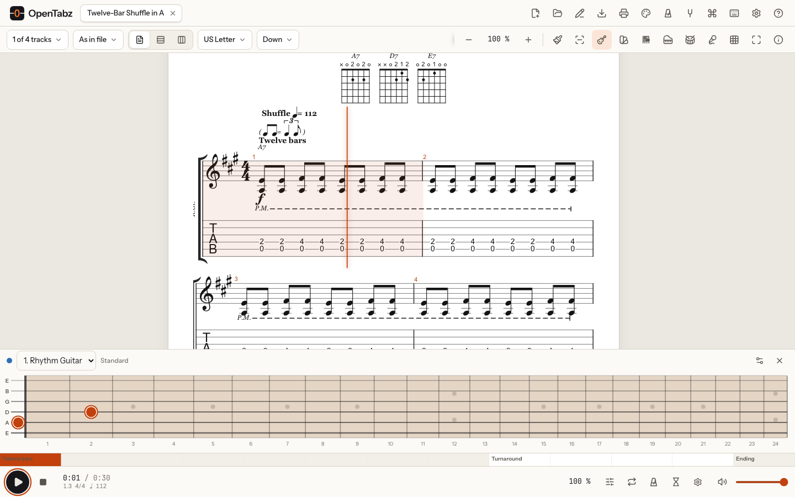
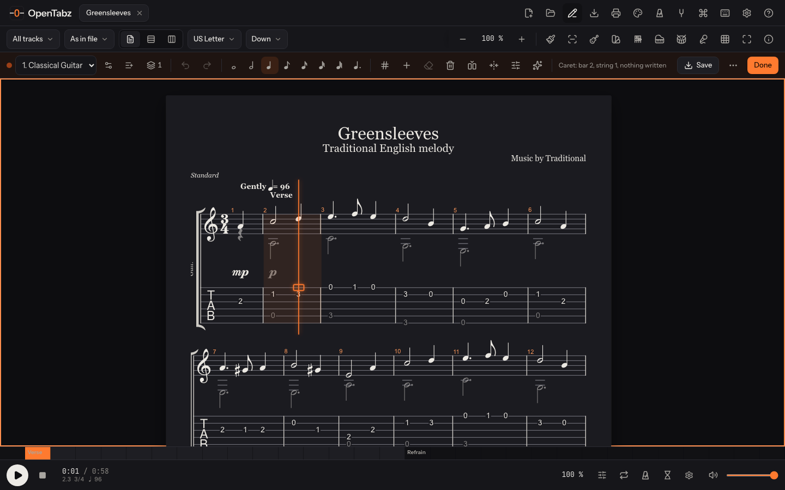

<p align="center">
  <a href="https://opentabz.com">
    
  </a>
</p>

<h1 align="center">OpenTabz</h1>

<p align="center">
  <strong>Guitar tabs, beautifully engraved — free, open source, in your browser.</strong><br>
  Open, play, practise and write Guitar Pro files without installing anything.
</p>

<p align="center">
  <a href="https://opentabz.com"></a>
  <a href="https://github.com/ekinarca/opentabz/actions/workflows/ci.yml"></a>
  <a href="LICENSE"></a>
  <a href="#faq"></a>
  <a href="CONTRIBUTING.md"></a>
  <a href="https://github.com/ekinarca/opentabz/stargazers"></a>
</p>

<p align="center">
  <a href="https://opentabz.com"><b>Open the app</b></a> ·
  <a href="#how-to-use-it">How to use it</a> ·
  <a href="#features">Features</a> ·
  <a href="#run-it-yourself">Run it yourself</a> ·
  <a href="#contributing">Contributing</a>
</p>


OpenTabz opens **Guitar Pro, MusicXML, Capella and alphaTex** files right in the browser, engraves
them as notation and tablature, plays them back, helps you practise them and lets you write your
own. There is nothing to install and no account to make, and **your files never leave your
device**: there is no server to upload them to. It works on phones, installs as an app and keeps
working offline.

The goal is simple and large: **everything Guitar Pro 8 does, then more, as free software.**
[docs/PARITY.md](docs/PARITY.md) maps all 701 Guitar Pro 8 capabilities to the work that delivers
them, and [docs/FEATURE_MATRIX.md](docs/FEATURE_MATRIX.md) tracks what is done, with the test
that proves each one.

> [!TIP]
> No file at hand? Open [opentabz.com](https://opentabz.com) and pick one of the demo songs at the
> bottom of the page: a blues shuffle, Greensleeves or an arpeggio study.

## Why OpenTabz

- **Free, for good.** No trial, no paywall, no ads. The code is AGPL, so it stays free.
- **Private by design.** Files are read in your browser. No uploads, analytics, cookies or tracking.
- **Everywhere.** Any current browser on Windows, macOS, Linux, ChromeOS, iOS or Android.
- **Familiar.** Keyboard shortcuts follow Guitar Pro 8, so switching costs you nothing.
- **Fast.** Interactive in well under a second; a 150-bar score is on screen about 150 ms after you
  drop it, and playback starts within 100 ms. These budgets are tested on every change.

## How to use it

### 1. Open a score

Go to **[opentabz.com](https://opentabz.com)**, then do any of these:

| Do this                                      | Result                                       |
| -------------------------------------------- | -------------------------------------------- |
| Drag files onto the page                     | Each opens in its own tab                    |
| Click **Open a file** (`Ctrl O` / `⌘ O`)     | Pick files from your computer or phone       |
| Paste a file, or paste alphaTex text         | It opens straight away                       |
| Click **Open from a link**                   | Opens a score from the web (CORS permitting) |
| Share a link like `opentabz.com/?url=<file>` | The score opens for whoever follows it       |
| Click **New score**                          | Starts a blank score to write in             |

Supported: Guitar Pro 3, 4, 5 (`.gp3`, `.gp4`, `.gp5`), 6 (`.gpx`), 7 and 8 (`.gp`), MusicXML
(`.xml`, `.musicxml`, `.mxl`), Capella (`.capx`) and alphaTex (`.atex`). Files are recognised by
their content, so a wrong extension does not matter. If a file cannot be opened, OpenTabz tells
you exactly why: truncated, damaged, or a format it recognises but does not open yet.

### 2. Read it your way


The toolbar above the score chooses what you see:

- **Tracks** — any selection of the song's instruments.
- **Staves** — notation and tab, either one alone, or as the file asks.
- **Layout** — pages (A4, US Letter or your own size), one vertical scroll, or one endless line.
- **Zoom** — 25 % to 400 %, or pinch on a touch screen.
- **Theme** — light, dark, sepia or a high-contrast stage theme (the palette icon, top right).

### 3. Play it

Press **Space** (or the play button) to play. Click any note to start from there. OpenTabz plays
what is written: repeats and alternate endings, D.C. / D.S. / Coda / Fine in Guitar Pro's order,
fermatas, hairpins, tempo ramps, bends, slides, palm mutes and the rest.

- **Speed** — 10 % to 300 % without changing the pitch: `-` and `=` step it by 5 %, or tap a tempo.
- **Mixer** — mute, solo, volume, pan, instrument or drum kit, transposition and fine tuning per
  track; it is remembered for each file.
- **Song map** — the strip above the play bar shows every bar and section; click to jump there.
- **Following** — choose how the cursor and the page follow the music, and colour the notes.

### 4. Practise it


1. **Select the hard part**: drag across the music, long-press a bar on a phone, or type the bar
   numbers.
2. **Loop it** with the loop button (`F9`): endlessly or a set number of times, with rest bars
   between passes if you like.
3. **Slow it down**, then turn on the **speed trainer** in the practice settings: it brings the loop
   up to tempo step by step after the passes you choose.
4. Turn on the **metronome** (`Alt M` / `⌥ M`) and a **count-in** (`Alt C` / `⌥ C`). The metronome
   has six sounds, subdivisions, swing, accents beat by beat, polyrhythms and silent bars.
5. **Mute your own part** in the mixer and play along with the band.

There is also a **tuner** (it listens through your microphone and follows the track's tuning) and
a **standalone metronome** with tap tempo for practising without a song. Both are in the top bar.

### 5. See it on the instrument



Open the **fretboard**, **keyboard** or **drums** view from the toolbar to see the notes on the
instrument as they play: the next notes or the whole bar, note names, a capo, left-handed.
**Chords** shows the song's chord diagrams with the next chord coming up, and **Lyrics** gives you
karaoke-style lyrics you can click to jump.

### 6. Write and edit



Press **`F2`** (or the pencil icon) to edit the score, or start a **New score**. The keys are
Guitar Pro's:

| Keys                        | What they do                                   |
| --------------------------- | ---------------------------------------------- |
| `←` `→` `↑` `↓`             | Move the caret between beats and strings       |
| `0` – `9`                   | Write a fret (type two digits for 10 to 99)    |
| `-` and `+`                 | Make the note longer or shorter                |
| `.` · `R` · `/` · `L`       | Dotted · rest · triplet · tie                  |
| `H` · `S` · `B` · `V` · `P` | Hammer-on · slide · bend · vibrato · palm mute |
| `Ctrl C` / `Ctrl V`         | Copy and paste (`⌘` on a Mac)                  |
| `Ctrl Z` / `Ctrl Shift Z`   | Undo and redo, as far back as you like         |
| `Insert` · `Ctrl Delete`    | Insert or delete a bar                         |

The edit bar also sets bars (time and key signatures, tempo, repeats, sections), tracks
(instrument, tuning, capo, colour), up to four voices, chords with a chord builder, transposition
and more. Your work is saved as you go and comes back after a crash or a closed tab. **Save**
writes a Guitar Pro `.gp` file you can open anywhere.

### 7. Export, print and share

The download icon exports **PDF, PNG, SVG, MIDI and WAV** (the whole song or just the selection),
the printer icon prints, and **Save** writes Guitar Pro. Nothing is uploaded: every file is made
on your device.

### 8. Install it and use it offline

In Chrome or Edge, use **Install** in the address bar; on an iPhone or iPad, **Share → Add to
Home Screen**. Installed, OpenTabz works with no connection; in Chrome and Edge it also opens score files from
your file manager, and on Android it appears in the share menu.

<p align="center"></p>

> [!NOTE]
> Every action is also in the **command palette** (the ⌘ icon in the top bar), and `?` shows every
> keyboard shortcut. Any shortcut can be changed in the shortcut sheet. The full list is in
> [docs/SHORTCUTS.md](docs/SHORTCUTS.md).

## Features

<table>
<tr>
<td valign="top" width="50%">

**Open**

- Guitar Pro 3–8, MusicXML, Capella, alphaTex
- Drag and drop, paste, links and `?url=` deep links
- Several scores at once, in tabs
- Recent scores and your last session

**Read**

- Notation, tab, slash and numbered notation
- Page, vertical and horizontal layouts
- Four themes, zoom 25–400 %, full screen
- Song info, song overview, section navigator

**Play**

- SoundFont synthesis off the main thread
- Repeats, jumps, fermatas, hairpins, tempo ramps
- Mixer with per-track instrument, pan, transpose
- Playing styles: let ring, strum, palm-mute damping

</td>
<td valign="top" width="50%">

**Practise**

- Loops, A/B points, counted loops, rest bars
- Speed trainer, fixed-tempo practice, tap tempo
- Metronome with sounds, swing, accents, polyrhythms
- Count-in, tuner, standalone metronome

**See**

- Fretboard, keyboard and drum views
- Chord diagrams with next-chord preview
- Karaoke lyrics, note names

**Write**

- Guitar Pro's keys, up to four voices, unlimited undo
- Bars, tracks, tunings, chords, techniques
- Transpose, harmonize, retune, palm-mute assistants
- Autosave, crash recovery, save as `.gp`

</td>
</tr>
</table>

## OpenTabz and Guitar Pro 8

|                                                     | Guitar Pro 8                | OpenTabz today                                                  |
| --------------------------------------------------- | --------------------------- | --------------------------------------------------------------- |
| Price and licence                                   | Paid, proprietary           | Free, open source (AGPL-3.0-or-later)                           |
| Runs on                                             | Windows and macOS (desktop) | Any current browser on any device, phones included; no install  |
| Opens Guitar Pro 3–8 and MusicXML                   | Yes                         | Yes                                                             |
| Opens Capella and alphaTex                          | No                          | Yes                                                             |
| Opens PowerTab, TablEdit, MIDI                      | Yes                         | Planned (MIDI M5, PowerTab and TablEdit M8)                     |
| Notation and tab; page, scroll and horizontal views | Yes                         | Yes                                                             |
| Playback, mixer, speed, metronome, count-in, loops  | Yes                         | Yes                                                             |
| Metronome sounds, subdivisions, accents, polyrhythm | Not documented              | Yes, plus swing, silent bars and a standalone metronome         |
| Speed trainer and tuner                             | Yes                         | Yes                                                             |
| Fretboard, keyboard and drum views                  | Yes                         | Yes                                                             |
| Writing and editing scores                          | Yes                         | Yes, and growing towards full parity (M4–M5)                    |
| Realistic instrument sound engine                   | Yes (RSE)                   | SoundFont playback now; a full sound engine is planned (M7)     |
| Export                                              | PDF, MIDI, MusicXML, audio  | PDF, PNG, SVG, MIDI, WAV, Guitar Pro; MusicXML and more planned |
| Works offline                                       | Yes                         | Yes, as an installed app                                        |
| Your files stay on your device                      | Yes                         | Yes: nothing is ever uploaded; no analytics, cookies, tracking  |

The milestones are described in [docs/FEATURE_MATRIX.md](docs/FEATURE_MATRIX.md).

## FAQ

**Is it really free?** Yes. No paid tier, no ads, no account. The AGPL licence keeps it that way.

**Where do my files go?** Nowhere. They are read and played in your browser; there is no server
that could receive them. Scores you edit are kept in your browser's own storage on your device.

**Which browser should I use?** Any current Chrome, Edge, Firefox or Safari, on desktop or phone.

**Can I edit Guitar Pro files and open them in Guitar Pro again?** Yes: **Save** writes a `.gp`
file that Guitar Pro 7 and 8 open.

**Something does not open or sounds wrong.** Please
[open an issue](https://github.com/ekinarca/opentabz/issues/new/choose) and attach the file if you
may share it. The error dialog has a button that copies the technical details.

## How it is built

A React interface on the main thread, and an engine in a Web Worker that reads files, lays out
and paints the music as SVG and generates MIDI with [alphaTab](https://github.com/CoderLine/alphaTab).
Sound is synthesized in a second worker and streamed to an AudioWorklet through shared memory,
so neither a busy interface nor a large score can make the audio stutter.

```text
apps/web          the app: React interface, score view, playback, editing (Vite)
packages/core     the engine: reading, layout, rendering, editing commands, export
packages/audio    the synthesizer worker and the AudioWorklet
packages/ui       shared interface components
docs/             architecture, decisions, research, feature matrix, shortcuts
fixtures/         public test scores (alphaTex, MusicXML test suite, alphaTab's files)
```

- [docs/ARCHITECTURE.md](docs/ARCHITECTURE.md) — how the pieces fit together
- [docs/DECISIONS.md](docs/DECISIONS.md) — architecture decision records
- [docs/RESEARCH.md](docs/RESEARCH.md) — measurements and research behind the decisions
- [docs/upstream/](docs/upstream/) — OpenTabz's changes to alphaTab, written up for upstream

## Run it yourself

Requirements: Node.js 24 and pnpm 10 (`corepack enable pnpm`).

```bash
git clone https://github.com/ekinarca/opentabz.git
cd opentabz
pnpm install
pnpm dev                 # http://localhost:5173
```

| Command                         | What it does                                          |
| ------------------------------- | ----------------------------------------------------- |
| `pnpm check`                    | Typecheck, lint, format check and unit tests          |
| `pnpm build`                    | Production build in `apps/web/dist`                   |
| `pnpm preview`                  | Serve the production build                            |
| `node scripts/check-budgets.ts` | Bundle size budgets for the build                     |
| `pnpm test:e2e`                 | End-to-end tests and performance budgets (Playwright) |
| `pnpm fixtures`                 | Regenerate `fixtures/generated/`                      |

The end-to-end tests run against the production build with the production security headers, in
Chromium, Firefox and WebKit, on desktop and phone viewports. Install the browsers once with
`pnpm --filter @opentabz/web exec playwright install`.

`apps/web/dist` is a static site: host it anywhere that can send the headers in
`apps/web/public/_headers` (cross-origin isolation is needed for the audio).

## Contributing

Contributions of every size are welcome: bug reports with a file that misbehaves, fixes, features
from the [feature matrix](docs/FEATURE_MATRIX.md), or better docs. Start with [CONTRIBUTING.md](CONTRIBUTING.md) and the
[code of conduct](CODE_OF_CONDUCT.md). Security issues go to [SECURITY.md](SECURITY.md), never to
a public issue.

If OpenTabz is useful to you, **a star helps other guitarists find it** ⭐

## Licence and credits

OpenTabz is free software under the [GNU Affero General Public License v3.0 or later](LICENSE).

It stands on [alphaTab](https://github.com/CoderLine/alphaTab) by Daniel Kuschny and contributors
(MPL-2.0), the [Bravura](https://github.com/steinbergmedia/bravura) music font by Steinberg
(OFL-1.1) and the SONiVOX EAS sound bank (Apache-2.0). Every third-party component is listed in
[THIRD_PARTY_NOTICES.md](THIRD_PARTY_NOTICES.md).

Guitar Pro is a registered trademark of Arobas Music. OpenTabz is not affiliated with, endorsed
by or sponsored by Arobas Music; the name is used only to describe which files OpenTabz opens.

<p align="center">OpenTabz is a <b>Whale Development Studios</b> product.</p>
